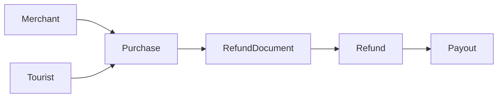

# TRS Refund Service

외국인 관광객 세금 환급(TRS) 도메인을 학습하고 확장하기 위한 **Kotlin + Spring Boot 4 샘플 프로젝트**입니다. 실서비스/세무 적합성을 인증한 구현이 아닙니다.

## 기술 스택

| 구분 | 기술 |
|---|---|
| Language | Kotlin 2.2.21 / JDK 21 |
| Backend | Spring Boot 4.0.1 / Spring MVC |
| Persistence | Spring Data JPA / Hibernate / Querydsl 5.1.0 (Jakarta) |
| Build | Gradle Kotlin DSL / kapt |
| Test | Kotest 6.0.4 (BehaviorSpec BDD), MockK 1.14.6 |
| DB | H2 (개발) / PostgreSQL 드라이버 (운영) |

> **호환성 주의**: Spring Boot 4와 Querydsl 5.1.0 간 통합은 이 환경에서 실제 빌드·통합 테스트로 검증하지 못했습니다. Hibernate 7의 변경으로 Querydsl JPA 구현에 추가 호환성 조정이 필요할 수 있습니다. DB dialect 및 라이브러리 호환성 검증 후 프로덕션에 적용하세요.

## 실행

1. JDK 21, Gradle 8.14+ 또는 Boot 4를 지원하는 최신 Gradle 설치.
2. 프로젝트 루트에서 다음 실행:

```bash
gradle bootRun
gradle test
```

> Gradle Wrapper 바이너리는 ZIP에 포함하지 않았습니다. 로컬 설치 Gradle로 `gradle wrapper`를 실행한 뒤 `./gradlew bootRun`을 사용하세요.

기본 포트: `8080`, 개발 DB: H2 인메모리. 기본 프로필은 재시작 시 데이터가 삭제됩니다.

PostgreSQL 환경에서 실행할 때는 `--spring.profiles.active=prod`와 `DB_URL`, `DB_USERNAME`, `DB_PASSWORD`를 설정하세요. 운영 프로필은 스키마 자동 생성을 하지 않으므로 별도의 DB 마이그레이션이 필요합니다.

## 프로젝트 구조

```text
src/
├── main/
│   ├── kotlin/com/example/trs/
│   │   ├── TrsApplication.kt
│   │   ├── api/                     # REST API, 예외 처리
│   │   ├── application/             # 유스케이스, 트랜잭션
│   │   ├── config/                  # Querydsl JPAQueryFactory
│   │   ├── domain/                  # Merchant, Tourist, Purchase, RefundDocument, Refund, Payout
│   │   └── repository/              # JPA + Querydsl custom repository
│   └── resources/                   # 개발/운영 YAML
└── test/kotlin/com/example/trs/
    ├── domain/                      # Kotest BehaviorSpec
    └── application/                 # Kotest + MockK
```

## 도메인 흐름



환급 상태 흐름: `REQUESTED → APPROVED → PROCESSING → COMPLETED / FAILED`. `REQUESTED → CANCELLED`도 허용합니다. 상태 전이 메서드는 `Refund` 엔티티 내부에 유지합니다.

- `Merchant`: 가맹점 정보
- `Tourist`: 관광객(여권 원문 대신 가상 식별 토큰 사용)
- `Purchase`: POS 거래, `(merchant_id, external_tx_id)` 유니크
- `RefundDocument`: 구매 거래별 환급전표
- `Refund`: 금액 및 상태, `@Version`을 이용한 낙관적 잠금
- `Payout`: 환급 지급 요청 기록, 멱등키 유니크

**예제 정책 가정**: 환급전표 하나당 환급 1건, 금액은 0 초과 및 구매금액 이하. 이는 실서비스의 실제 세액/수수료 계산 정책을 구현한 것이 아닙니다. DB 제약조건만으로 모든 비즈니스 중복과 레이스 컨디션을 해결할 수 없습니다.

## API

| Method | Path | 동작 |
|---|---|---|
| POST | `/api/v1/refunds/documents/{documentId}` | 환급 신청 |
| POST | `/api/v1/refunds/{refundId}/approve` | 환급 승인 |
| POST | `/api/v1/refunds/{refundId}/prepare-payout` | 지급 요청 생성 (송금하지 않음) |
| GET | `/api/v1/refunds/{refundId}` | 상세 조회 |
| GET | `/api/v1/refunds?status=APPROVED&merchantId=1` | Querydsl 조건 검색 |

환급 신청 예시 (사전 생성된 전표가 있어야 함):

```bash
curl -X POST http://localhost:8080/api/v1/refunds/documents/1 \
  -H 'Content-Type: application/json' \
  -d '{"amount":7000}'
```

> 샘플에는 관광객·가맹점·구매·전표 생성 API 및 시드 데이터가 없습니다. 환급 API 실행에는 해당 데이터를 DB에 선행 생성해야 합니다.

## Querydsl

`RefundQueryRepositoryImpl`에서 상태/가맹점 조건을 `where(status?.let { ... }, merchantId?.let { ... })`로 조합합니다. `kapt`로 `QRefund` 클래스를 생성합니다.

## 테스트

- `RefundBehaviorSpec`: BDD Given/When/Then 스타일 상태 전이와 예외 확인
- `RefundServiceBehaviorSpec`: MockK로 저장 호출과 지급 요청 확인
- 아직 포함하지 않은 테스트: `@DataJpaTest` 통합 테스트, API 테스트, 실제 PostgreSQL/Testcontainers 테스트

## 운영 전 필수 보완

1. 실제 환급 자격 검증(국적/체류/품목/기간), 법규 기반 환급 금액 계산 및 정책 버전 관리
2. 반출 확인(`ExportConfirmation`), 구매품목(`PurchaseItem`), 정산(`Settlement`) 도메인 추가
3. 지급 프로세서 + Transactional Outbox + 지급기관 멱등키/조회/재시도/대사
4. OAuth2/API 인증·인가, 여권 개인정보 암호화 및 접근 감사
5. Flyway/Liquibase DB 마이그레이션, DB 인덱스, 장애·모니터링
6. 중복 요청 경합 테스트 및 확실한 멱등 동작 보장
7. PostgreSQL 및 Spring Boot 4/Hibernate/Querydsl 통합 호환성 검증

## 설계 원칙

- Kotlin JPA 엔티티는 `kotlin("plugin.jpa")`의 no-arg 생성자 지원을 사용합니다.
- 연관 관계는 명시적 `LAZY` 로딩이 기본입니다.
- 금액은 `BigDecimal`, 주문 거래번호·전표번호·지급 키는 DB UNIQUE로 보호합니다.
- 외부 송금은 DB 트랜잭션 안에서 호출하지 않습니다.
- 쿼리·서비스·도메인의 책임을 분리하고 상태 변경은 도메인 메서드를 거칩니다.

## 참고 문서

- [Spring Boot](https://docs.spring.io/spring-boot/4.0/)
- [Querydsl](https://github.com/querydsl/querydsl)
- [Kotest Spring](https://kotest.io/docs/extensions/spring.html)

## 계층별 Kotest BDD 테스트 (확장)

모든 시나리오는 `Given → When → Then`으로 구분되며, **도메인 → 서비스 → Controller → JPA 통합** 순서로 검증할 수 있습니다.

| 범위 | 파일 | 실제 객체/Mock | 검증 내용 |
|---|---|---|---|
| JPA 도메인 | `domain/RefundBehaviorSpec.kt` | 실제 엔티티 | 0/음수 금액, 상태 전이, 재진입·종료 상태 방어 |
| JPA 도메인 | `domain/PurchaseBehaviorSpec.kt` | 실제 엔티티 | 구매 완료/취소 환급 가능 여부 |
| Repository | `repository/RefundRepositoryBehaviorSpec.kt` | 실제 H2, Spring Data JPA, Querydsl | 중복 전표/멱등키 제약, POS 검색, 상태·가맹점 복합 검색 |
| Service | `application/RefundServiceBehaviorSpec.kt` | MockK Repository | 요청·승인·지급·조회·검색, 중복/금액/취소 검증, 저장 호출 횟수 |
| Controller | `api/RefundControllerBehaviorSpec.kt` | standalone MockMvc + MockK Service | 201/200/400/404/409 HTTP, JSON 응답, Bean Validation, 위임 검증 |

### 실행

```bash
gradle test
# 특정 계층만
gradle test --tests '*domain.*'
gradle test --tests '*repository.*'
gradle test --tests '*application.*'
gradle test --tests '*api.*'
```

**테스트 분리 원칙:** 단위 테스트는 Spring 컨텍스트를 띄우지 않으며 MockK로 외부 의존성을 차단합니다. Repository만 `@SpringBootTest`로 H2 실 DB와 JPA/Querydsl을 검증합니다. 각 서비스/컨트롤러 시나리오의 Mock은 독립적으로 생성합니다. Repository 테스트는 UUID 기반 독립 테스트 데이터를 사용하고 각 시나리오의 쓰기는 개별 DB 트랜잭션으로 묶습니다.

**제약:** DB 테스트는 H2 방언 테스트로서 실제 PostgreSQL과 완전히 동일한 검증은 아닙니다. 실제 DB에서는 Testcontainers/PostgreSQL 기반 추가 검증을 권장합니다. 이 압축본의 새 테스트는 실행 환경에서 Gradle 실행 파일을 확인하지 못하여 컴파일/실행 검증을 완료하지 못했습니다.


## 테스트 계층 분리 (Kotest BehaviorSpec / MockK)

| 계층 | 경로 | 방식 | 검증 항목 |
|---|---|---|---|
| JPA Entity | `src/test/.../domain` | Pure BehaviorSpec | 상태 전이, 불변식 |
| Service | `src/test/.../application` | BehaviorSpec + MockK | 정책·예외·협력 객체 호출 |
| Controller | `src/test/.../api` | MockMvc + MockK | JSON·HTTP 상태 코드 |
| Repository (빠른 로컬) | `src/test/.../repository` | SpringBootTest + H2 | Querydsl, 제약, 조회 |
| Repository (실제 DB) | `src/test/.../integration/PostgresRepositoryBehaviorSpec.kt` | @DataJpaTest + Testcontainers PostgreSQL | 실제 PostgreSQL SQL, Querydsl 필터 |
| Concurrency | `src/test/.../integration/RefundConcurrencyBehaviorSpec.kt` | 2-thread + Testcontainers PostgreSQL | 동일 환급 지급요청 경합, DB lock |

### 명령어

```bash
gradle test                  # 단위 + H2 Repository + Controller
gradle integrationTest       # Docker 필요: PostgreSQL Repository + 동시성
gradle allTests              # 위 두 작업
gradle jacocoTestReport      # build/reports/jacoco/test/html/index.html
gradle jacocoTestCoverageVerification # 전체 60% 커버리지 게이트 (예시)
```

> 단일 Gradle `test` 작업에서 integration 패키지를 제외합니다. `integrationTest`는 동일한 test 소스셋을 재사용하고 `**/integration/**` 경로만 선택합니다. 로컬 Docker 데몬이 필요합니다. 각 Testcontainers 스펙은 독립 컨테이너를 사용하여 테스트 간 간섭을 줄입니다.

### 동시성 방지 구조

- `preparePayout`은 같은 DB 트랜잭션에서 `findByIdForUpdate` (`PESSIMISTIC_WRITE`) → 상태 전이 → 지급 요청 INSERT를 수행합니다.
- 동일 환급의 경쟁 호출 중 하나만 `APPROVED -> PROCESSING`에 성공하도록 테스트합니다.
- `payouts.idempotency_key` UNIQUE 제약도 유지하지만, UUID 기반 키는 **반복 요청의 안정적인 멱등키로는 부족**합니다. 실서비스에서는 클라이언트 제공 요청 ID 또는 환급 ID/지급 시도번호를 영속화하고, 외부 지급기관에도 동일한 멱등키를 전달해야 합니다.
- `request(documentId)` 역시 현 구현은 `exists` 검사 + INSERT이므로 경쟁 요청 시 UNIQUE 제약 위반이 발생할 수 있습니다. API에서 해당 충돌을 일관된 409 응답으로 매핑하는 개선이 필요합니다.

### 제한 사항

- Spring Boot 4 + Querydsl 5.1 + Jakarta/Hibernate 7 조합은 실제 Gradle 빌드가 확인되지 않았습니다. CI에서 의존성/런타임 호환성을 검증하세요.
- 동시성 테스트는 DB 락 경합을 검증하지만 외부 지급기관까지 포함한 exactly-once 지급 보장은 다루지 않습니다.
- Gradle Wrapper는 포함되어 있지 않습니다. `gradle`이 설치된 환경에서 명령을 실행하세요.
